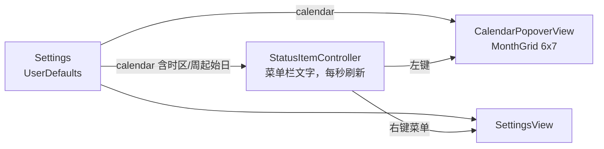

# Calendr（极简版）

菜单栏显示时间，点击弹出月历，两者都支持自定义时区。无事件/待办、无自动更新、无第三方依赖。

## 使用

```bash
scripts/build-app.sh                       # 生成 build/Calendr.app
cp -R build/Calendr.app /Applications/
open /Applications/Calendr.app
```

- 左键：月历（上/下月、回到今天、点选日期）
- 右键：设置、退出
- 设置：时区、菜单栏格式、每周起始日、周数、周末高亮、开机启动

开发：`swift build` / `swift test`。

## 结构



## 时区

`Settings.calendar` 是唯一入口：系统 `Calendar.autoupdatingCurrent` 加上自定义时区和周起始日。
所有格式化、"今天"判断、月历网格都用它，所以不需要处理事件的浮动时间问题，也不需要午夜通知：
弹窗和菜单栏每秒按所选时区重新计算，跨天自动更新。

## 后续可加

农历、多时区同时显示、全局快捷键、事件（EventKit）。
